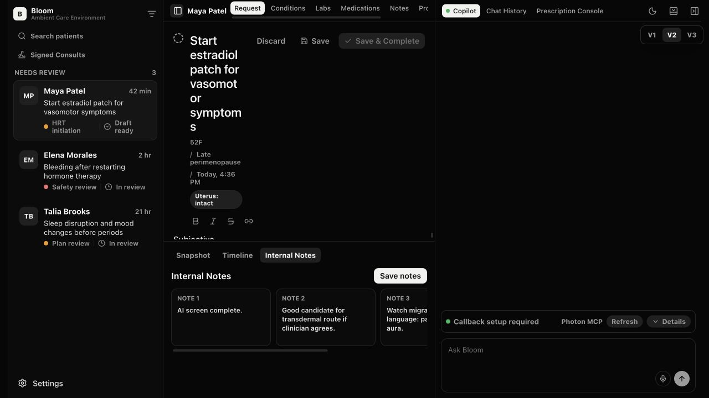
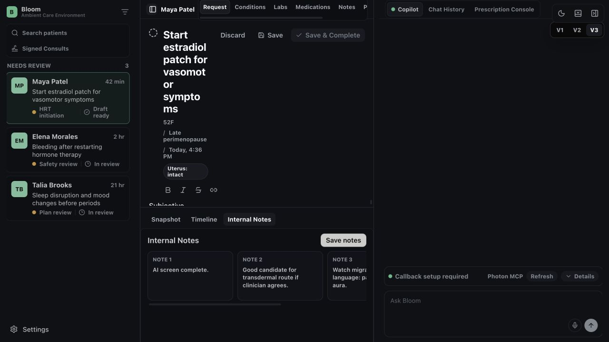
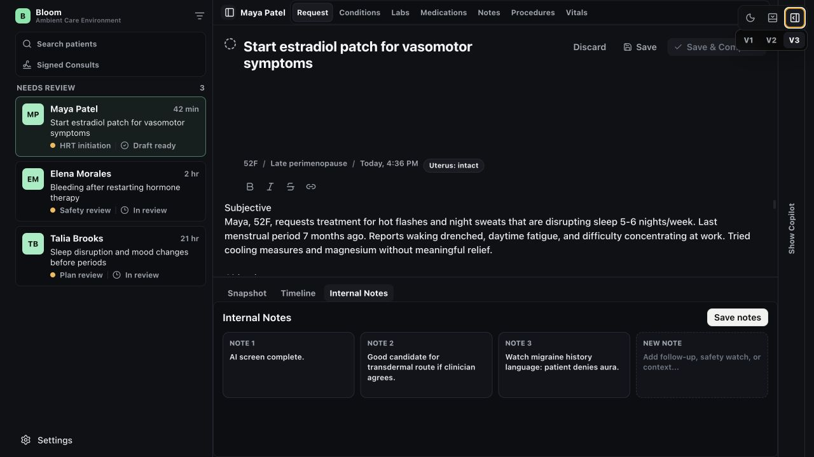
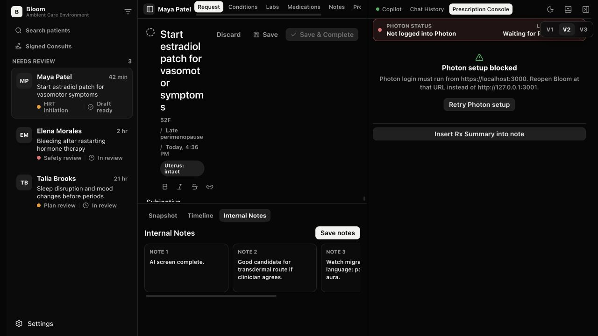
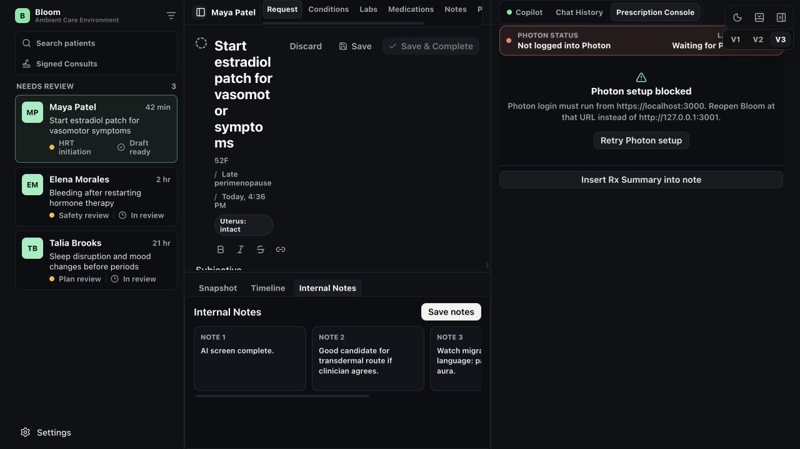
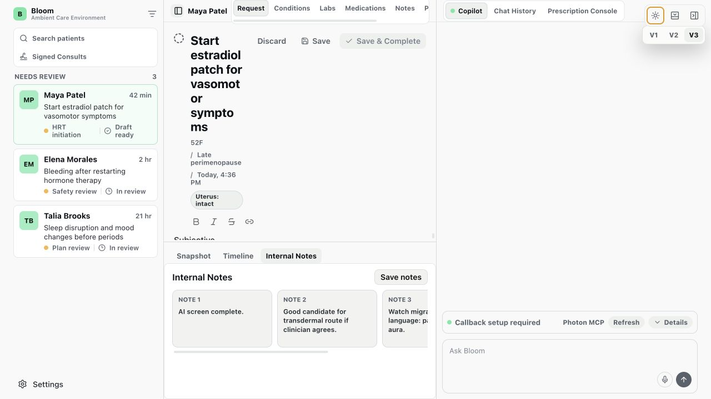
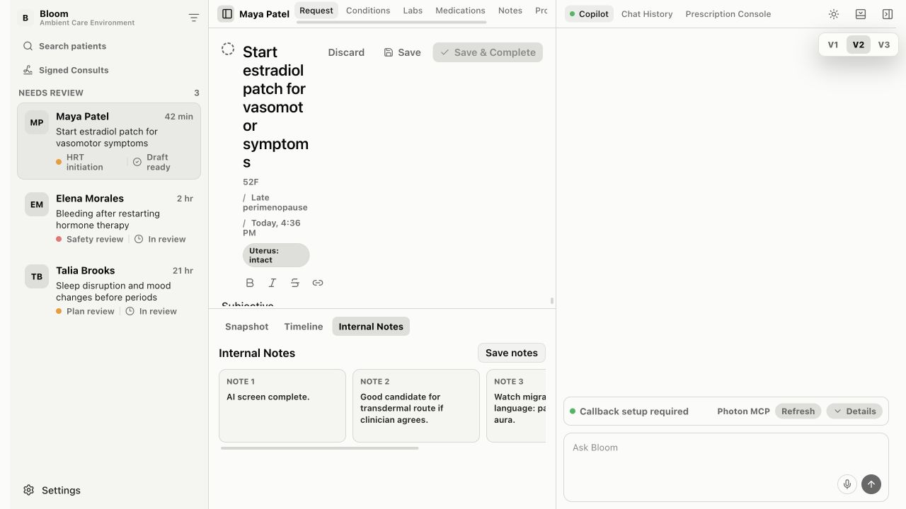

# Bloom V2/V3 design-development audit

Date: 2026-08-04

## Audit scope

This is an audit-first pass. It compares V2 and V3 visually and behaviorally, inspects their implementation boundaries, checks representative clinician and prescribing interactions, and evaluates alignment with the current coss ui approach. It does not modify the app implementation.

User goal: choose one coherent design-development direction that preserves the strongest parts of V2 and V3, removes misleading or dead prototype code, and gives engineers a reliable UI foundation without prematurely productionizing the prototype.

## Executive verdict

V3 is not a separate product iteration. It reuses the V2 component behavior (`componentVariant === "v2"`) and nearly identical shell markup, then applies a large root-scoped CSS override layer. The likely intent was to explore a flatter, more neutral, more component-system-like visual treatment. That experiment produced some useful improvements, but the CSS-overlay approach also made the design harder to reason about.

The best unified direction is:

- Use V3's calmer charcoal palette, clearer panel borders, larger tab targets, stronger heading weight, and more coherent light/dark tokens.
- Use V2's quieter neutral patient selection, higher-contrast active tabs, simpler top navigation, and softer light-theme surface hierarchy.
- Fix the shared three-panel layout before choosing either skin. At the captured 1280px viewport the request title is reduced to about 94px while the right panel remains 480px wide, making both variants unusable in the default state.
- Replace the custom interaction-primitives layer with selected coss ui primitives and semantic tokens. Keep Bloom-specific clinical workspace components as app-level compositions.
- Remove V1 and the V1/V2/V3 switcher from the engineer handoff after the unified direction is approved. Keep a design comparison only as an audit artifact or dev-only route.

## Why V3 appears to exist

There is no commit history in this checkout, so the original rationale cannot be recovered from Git. The current code supports this reconstruction:

- `workspaceVariant` distinguishes `/v2` and `/v3`, but both become the same `componentVariant: "v2"`.
- The V2 and V3 render branches are functionally identical except for `data-ui-variant`.
- V3 adds a new palette, stronger weights, grouped control surfaces, green selection treatments, 30px tab controls, and flatter card/panel styling through 71 root-scoped CSS selectors.

V3 should therefore be treated as a visual treatment experiment over V2, not as a separate feature version.

## Evidence steps

### 1. V2 default workspace — poor at the captured viewport

Strengths: neutral patient selection is appropriately quiet; active top tabs have strong contrast; the right panel feels visually subordinate until it contains work.

Risks: the fixed three-panel allocation leaves the request title only about 94px wide, producing severe word fragmentation; small muted labels and 20px editor controls are difficult to read and target; the floating variant switcher overlaps application chrome.

### 2. V3 default workspace — mixed, with the same structural failure

Strengths: more coherent charcoal surfaces, clearer panel boundaries, stronger headings, larger tab controls, and a more legible queue-card structure.

Risks: the green selected-patient treatment reads like a clinical status instead of navigation state; boxed groups appear around too many navigation areas; active tabs are less immediately distinct than V2; the same request-title collapse remains.

### 3. V3 with the right panel collapsed — healthy core workspace

The central chart becomes readable immediately. This proves the core content hierarchy is viable and the main problem is responsive panel policy, not the request design itself. The vertical `Show Copilot` rail is visually awkward and should become a standard collapsible/sidebar trigger.

### 4. V2 prescription transition — functionally healthy

The tested flow successfully generated a prescription card and transitioned to Prescription Console. Photon setup is blocked only because the audit used a temporary HTTP preview to avoid the self-signed local certificate; the normal app expects `https://localhost:3000`.

### 5. V3 prescription transition — functionally healthy

V3 completes the same transition because it shares V2's component behavior. The screen again shows that V3 is a skin over V2, not a distinct workflow.

### 6. V3 light theme — mixed

The light theme has clear card boundaries and consistent accents, but the white-on-white workspace is visually flat and the green patient-selection treatment remains semantically too strong.

### 7. V2 light theme — mixed

V2's warmer queue and neutral selection feel calmer for long clinical review, while panel and control boundaries are less systematic than V3.

## Highest-impact findings

### P0 — Fix before visual consolidation

1. **Shared layout breaks at a common desktop width.** The `max-width: 1320px` rule keeps three large panels visible and gives the chart only about 492px. The request action row does not wrap or stack, so the editable title collapses to about 94px. Use an explicit panel policy: collapse or overlay Copilot below a threshold, allow user-sized rails, and stack request actions before the title becomes unreadable.

2. **The app resembles coss visually but is not currently built on coss ui.** There is no Tailwind, Base UI, coss style preset, or copied coss primitive layer in the dependency or source structure. Current buttons, tabs, popovers, selects, tooltips, toggles, and focus behavior are custom CSS/HTML. The official coss approach is copy-owned React primitives built on Base UI and Tailwind v4 with semantic tokens. Migrate interaction-heavy primitives first; do not rewrite Bloom-specific chart compositions as generic primitives.

3. **Keyboard focus is not reliably visible.** Many inputs and textareas explicitly remove outlines, while only queue navigation and resizers define `:focus-visible`. Use coss focus-ring behavior consistently. The captured audit could not complete a reliable full keyboard traversal in the in-app browser, so final keyboard order and focus trapping still require manual/browser testing.

4. **Tab state is visual only.** Chart, copilot, patient-context, and timeline tabs are navigation elements containing buttons with a `selected` class, but do not expose tab roles, `aria-selected`, `aria-controls`, or panels. Replace these with the coss Tabs primitive or implement the complete tab contract.

### P1 — Consolidate the design-development codebase

5. **V2 and V3 duplicate the same shell markup.** Collapse the two branches into one `WorkspaceShell` and separate behavior from visual treatment. A route should not determine whether shared component behavior is called `v2`.

6. **V3 is a specificity-heavy override layer.** Seventy-one selectors begin with the V3 root selector, including broad overrides for all inputs, cards, tabs, and buttons. Convert differences to semantic tokens and component variants. Avoid page-root descendant selectors for primitive behavior.

7. **The stylesheet and feature files are too broad for handoff.** `App.css` is 3,652 lines; `ChartWorkspace.tsx` is 1,588 lines; `App.tsx` and `CopilotPanel.tsx` are each about 793 lines. Split by tokens/primitives, workspace shell, queue, chart, copilot, and prescribing. This is a design-system boundary problem, not a request for production-layer architecture.

8. **There are misleading non-functional controls.** The current UI includes visible controls without actions: Save notes, Profile, Settings, Usage remaining, Log out, agent Copy/Helpful/Not helpful, Edit draft order, Draft patient message, V1 Internal Notes, and the intentionally disabled Pop out action. Remove them, make them explicitly demonstrative, or implement the small local interaction needed to communicate the intended design. Do not hand off clickable dead ends.

9. **The settings mock contains a hardcoded personal email.** Replace it with neutral seed identity or remove the account section if account management is not part of this prototype.

10. **Prompt routing has a concrete classification bug.** The regex uses a word boundary around `prescri`, so a natural prompt containing `prescription` was routed to a plan draft. Use an explicit action chooser/command or correct the parser; do not make a clinically consequential mode depend on a brittle partial-word regex.

### P2 — Polish and accessibility hardening

11. **Editor toolbar targets are only 20x20px.** Increase to at least 24x24px, preferably the coss button/icon-button size used elsewhere.

12. **Selection and clinical status colors are conflated in V3.** Keep green for success/connection/clinical state. Use a neutral selected-navigation token for the active patient row.

13. **Small muted text is overused.** Brand subtitle is 10px and several metadata labels rely on low-contrast muted colors. Preserve compact density, but raise minimum text size/contrast for essential patient and workflow information.

14. **The draggable V1/V2/V3 switcher is design tooling inside the product surface.** It overlaps window controls and prescription content. Move it to a dev-only toolbar or remove it after consolidation.

15. **Prototype artifacts are mixed with app source.** `.playwright-mcp/`, `src/.DS_Store`, the old root comparison PNG, and the unused `playwright` dependency should be removed or intentionally incorporated into a scripted visual-smoke-test workflow. The favicon is used and should stay.

## Recommended coss boundary

Use coss ui for the parts where accessibility and behavior are expensive to reproduce:

- Button and icon button
- Tabs and toggle groups
- Tooltip
- Popover/menu
- Select and field/label
- Textarea/input
- Collapsible/sidebar controls
- Scroll Area
- Separator
- Badge/status presentation
- Dialog, Sheet, or Drawer when overlay behavior is intended

Keep Bloom-owned compositions for:

- Consult queue row and clinical worklist
- Patient chart workspace
- Request editor and encounter-artifact workflow
- Copilot action card
- Prescription console and Photon integration boundary
- Patient snapshot/timeline/internal-notes compositions

Map the current palette to coss/shadcn-compatible semantic tokens (`background`, `foreground`, `card`, `popover`, `muted`, `accent`, `border`, `input`, `ring`, `success`, `warning`, `destructive`, and sidebar tokens). Keep only genuinely clinical additions. The current `panel`/`surface` ladder should not remain a parallel design system unless a token has a distinct semantic purpose.

Official references:

- [coss ui Get Started](https://coss.com/ui/docs/get-started)
- [coss ui Styling](https://coss.com/ui/docs/styling)
- [coss ui component and migration skills](https://coss.com/ui/docs/skills)

## Proposed unified direction

1. Create one canonical COSS-aligned route from the V2 behavior set.
2. Adopt V3's base charcoal/neutral tokens and clearer structural borders.
3. Restore V2's neutral queue selection, bright active tabs, and simpler unboxed header navigation.
4. Carry V2's warmer light-theme queue/surface relationship into the semantic token set.
5. Replace primitive interactions with coss components in one bounded pass.
6. Fix the desktop panel policy and request-header reflow.
7. Remove dead controls, private seed identity, V1-only concepts, duplicate branches, and dev-only variant UI.
8. Run a second visual and accessibility audit on the consolidated route before handoff.

## Evidence limits

- No Git commits exist in this checkout, so the historical reason for V3 is inferred from current implementation structure rather than confirmed chronology.
- The audit covered representative V2/V3 default, collapsed-panel, light-theme, AI draft, and prescription-console states. It did not exhaustively execute every chart tab, settings choice, resize gesture, Photon login, or every seeded consult.
- Photon Elements could not authenticate in the temporary HTTP capture origin. The route transition and blocked-state UI were verified; the external prescribing workflow was not.
- Screenshot and DOM review can identify accessibility risks but cannot establish WCAG compliance. Keyboard order, screen-reader announcements, zoom/reflow, focus trapping, and contrast should be re-tested after consolidation.

